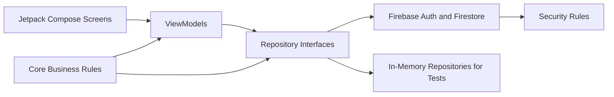

# LPMS Mobile

**Literacy Programme Management System (LPMS)** is an Android application built for **READ Educational Trust** to help staff manage school literacy programmes, track learner attendance and reading progress, and communicate with parents and guardians.

Developed by **Team Point Blank** for XISD6329 Task 2.


---

## Table of contents

- [About](#about)
- [Key features](#key-features)
- [Technology stack](#technology-stack)
- [Architecture](#architecture)
- [Project structure](#project-structure)
- [Security and privacy](#security-and-privacy)
- [Getting started](#getting-started)
- [Running tests and building](#running-tests-and-building)
- [Continuous integration](#continuous-integration)
- [Documentation](#documentation)
- [Known limitations](#known-limitations)
- [Contributors](#contributors)

## About

READ Educational Trust supports under-resourced schools through a three-year literacy programme. LPMS Mobile digitises the workflow for administrators, coordinators, teachers, parents and learners so that programme information is available in one place.

The app supports programme scheduling, attendance registers, learner progress tracking, parent communication, funder reporting and user administration. It is designed for real schools where internet connectivity may be unreliable.

## Key features

### Role-based access

| Role | Main capabilities |
| --- | --- |
| **Administrator** | Approve accounts, assign roles/schools/grades, suspend users, view the activity log and load demo data |
| **Coordinator** | Manage schools and learners, link parents, schedule/close/reopen sessions, record school visits and generate funder reports |
| **Teacher** | View their class, schedule sessions, mark and close attendance registers, record learner progress and message parents |
| **Parent/Guardian** | View linked children's attendance and reading progress, and message teachers/coordinators |
| **Learner** | Use an assisted login to view personal attendance and progress |

### Programme tools

- Three-year school and box-library programme cycle
- Learner enrolment by school and grade
- Automatic teacher-class matching based on school and grade
- Session scheduling with duplicate-day protection
- Attendance register saving and closure audit trail
- Reading-level and learner-progress tracking
- School-visit logging
- Funder report generation with CSV export
- In-app messaging with role-based contacts

### Android support

- Jetpack Compose Material 3 interface
- Email/password and Google sign-in
- Offline indicator
- Firestore offline persistence for saved changes
- CSV file sharing through Android's share sheet
- Minimum Android version: **8.0 (API 26)**

## Technology stack

| Area | Technology |
| --- | --- |
| Language | Kotlin 2.0.21 |
| UI | Jetpack Compose, Material 3 |
| Architecture | MVVM with repository interfaces |
| Local/offline support | Firebase Firestore offline persistence |
| Authentication | Firebase Authentication (email/password and Google) |
| Database | Cloud Firestore |
| Backend security | `firestore.rules` |
| Dependency management | Gradle Kotlin DSL and version catalogs |
| Testing | JUnit unit tests |
| CI | GitHub Actions |

### Version details

- Android Gradle Plugin: `8.7.3`
- Kotlin: `2.0.21`
-  firGradle used in CI: `8.9`
- Java: `17`
- Compile SDK: `35`
- Target SDK: `35`
- Min SDK: `26`
- Firebase BOM: `33.5.1`
- Compose BOM: `2024.10.01`

## Architecture

The app separates business rules, data access and presentation. The UI communicates through repository interfaces, while Firebase implementations provide the production data source. In-memory repositories allow core functionality to be unit tested without Firebase or an Android device.



Important business rules—including privacy scoping, attendance calculations, session lifecycle, grade handling, messaging permissions, programme cycles and report metrics—live in the `core` module and are covered by unit tests.

## Project structure

```text
lpms-mobile/
├── app/
│   ├── src/main/java/com/pointblank/lpms/
│   │   ├── core/model/          # Data models
│   │   ├── core/util/           # Business rules and calculations
│   │   ├── data/repository/     # Repository interfaces and in-memory versions
│   │   ├── data/firebase/       # Firebase Auth and Firestore implementations
│   │   ├── data/net/            # Network connectivity monitoring
│   │   ├── data/seed/           # Demo data and seeder
│   │   └── ui/                  # Compose screens, navigation and ViewModels
│   └── src/test/                # Unit tests
├── docs/
│   ├── SYSTEM_OVERVIEW.md       # Architecture and system behaviour
│   └── USER_GUIDE.md            # End-user instructions
├── .github/workflows/           # CI workflow
├── firestore.rules              # Firestore security rules
└── FIREBASE_SETUP.md            # Firebase configuration guide
```

## Security and privacy

LPMS handles personal information about children and is designed with POPIA-conscious access controls.

- Users can only register as **Teacher** or **Parent/Guardian**; coordinator and administrator roles must be assigned by authorised staff.
- Learner records are visible only to administrators, coordinators, the relevant teacher, the linked parent/guardian and the learner's own login.
- Parents can only see their linked children's information.
- Private conversations are readable only by the two participants; administrators cannot read users' messages.
- Firestore security rules enforce the same restrictions on the server, even if the app is modified.
- Attendance closures record the user and timestamp.
- `google-services.json` is excluded from version control and must be supplied locally or through CI secrets.

## Getting started

### Prerequisites

- Android Studio Ladybug or newer
- JDK 17
- A Firebase account
- A physical Android device running Android 8.0 or newer

### 1. Clone the repository

```bash
git clone <your-repository-url>
cd lpms-mobile
```

### 2. Configure Firebase

The app requires Firebase Authentication and Cloud Firestore. Follow **[FIREBASE_SETUP.md](FIREBASE_SETUP.md)** for the complete setup, including:

1. Creating a Firebase project
2. Registering package `com.pointblank.lpms`
3. Adding the debug SHA-1 fingerprint for Google sign-in
4. Enabling email/password and Google authentication
5. Downloading `google-services.json` to `app/google-services.json`
6. Publishing the rules from `firestore.rules`
7. Creating the first administrator

> `app/google-services.json` is intentionally not committed. The app will not build until this file is added.

### 3. Open and run

1. Open the project in Android Studio.
2. Allow Gradle to synchronise dependencies.
3. Connect a physical Android device.
4. Select the `app` configuration and click **Run**.

For first-time authentication and registration, an internet connection is required. Once signed in, Firestore can retain saved changes on the device and synchronise them later.

## Running tests and building

Unit tests cover the core business rules, repositories, calculations, validators, privacy scoping, messaging, session rules, programme-cycle behaviour, grading and demo seeding.

```bash
gradle testDebugUnitTest
```

Build a debug APK:

```bash
gradle assembleDebug
```

The debug APK is written to:

```text
app/build/outputs/apk/debug/
```

> If your repository includes the Gradle wrapper, use `./gradlew` instead of `gradle`.

## Continuous integration

The GitHub Actions workflow in `.github/workflows/android-ci.yml` runs on pushes and pull requests to `main` and `develop`.

It:

1. Sets up JDK 17
2. Decodes `GOOGLE_SERVICES_JSON` into `app/google-services.json`
3. Runs the unit tests
4. Builds a debug APK
5. Uploads test reports and the APK as workflow artifacts

To enable CI, base64-encode the Firebase configuration file and store it as a repository secret named `GOOGLE_SERVICES_JSON`.

```bash
base64 -w0 app/google-services.json
```

See **[FIREBASE_SETUP.md](FIREBASE_SETUP.md)** for the full GitHub Actions configuration instructions.

## Documentation

- **[FIREBASE_SETUP.md](FIREBASE_SETUP.md)** — Firebase, first-admin and CI-secret setup
- **[docs/SYSTEM_OVERVIEW.md](docs/SYSTEM_OVERVIEW.md)** — architecture, data model, roles, sessions, privacy and offline behaviour
- **[docs/DATABASE_DESIGN.md](docs/DATABASE_DESIGN.md)** — Firestore ERD, schemas, keys, relationships and access rules
- **[docs/USER_GUIDE.md](docs/USER_GUIDE.md)** — instructions for parents, teachers, coordinators and administrators

## Known limitations

- A teacher is associated with one school and one grade.
- Teachers at the same school and grade share the same learner class.
- Reading progress uses a single 1–5 level scale rather than language-specific assessment rubrics.
- Messaging is text-only and does not currently send push notifications.
- The interface is currently English-only.
- Saved report records are snapshots, while the Reports screen calculates figures live.

Possible future work includes multi-grade teacher assignments, richer assessment rubrics, push notifications and additional localisation.

## Contributors

**Team Point Blank** — XISD6329 Task 2