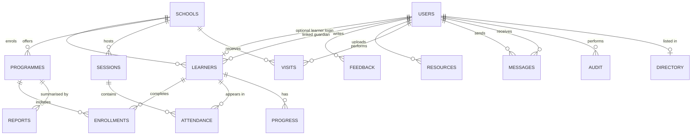

# LPMS Database Design

This document describes the Cloud Firestore database used by LPMS Mobile. It is intended to support the Task 2 database structure and table-design assessment criteria.

## 1. Database management system

| Item | Design choice |
| --- | --- |
| DBMS | **Google Cloud Firestore** |
| Service type | Hosted NoSQL document database |
| Firebase project | `lpms-pointblank` |
| Android access | Firebase SDK / Cloud Firestore API |
| Authentication | Firebase Authentication |
| Security | Firebase Authentication plus `firestore.rules` |
| Offline support | Firestore local persistence |

Firestore is a document database rather than a relational SQL database. The equivalent design terms are:

| Relational database | Firestore equivalent |
| --- | --- |
| Table | Collection |
| Row | Document |
| Primary key | Document ID |
| Foreign key | Document ID stored in a string field |
| Composite key | Deterministic document ID made from multiple values |

Firestore does not enforce foreign-key relationships itself. LPMS preserves relationships by storing document IDs and validating access and business rules in the application and security rules.

## 2. Design principles

1. **Document IDs are primary identifiers.** Most collections use the Firestore document ID as their stable `id`.
2. **Relationships use document IDs.** For example, `learners.schoolId` refers to a document in `schools`.
3. **Small, bounded relationships use arrays and maps.** Learner guardians and message participants are stored as arrays; guardian display names use a map.
4. **Frequently used display values are denormalised.** Session, visit and feedback records store names such as `facilitator` and `visitorName` to reduce joins/reads.
5. **Security filters are copied into child records.** Attendance and progress contain `schoolId` and `viewerIds`, allowing Firestore rules to check access without reading another document.
6. **Attendance has a deterministic composite ID.** Its document ID is `{sessionId}_{learnerId}`, preventing duplicate attendance rows for the same learner and session.
7. **User passwords are never stored in Firestore.** Firebase Authentication owns credentials; `users` contains profile and role information only.
8. **System-generated logs are append-only.** Staff can create audit records, while only administrators can read them. Editing and deleting are not permitted.
9. **Dates are explicit.** Calendar dates are ISO `YYYY-MM-DD` strings. Event times are epoch-millisecond numbers.
10. **Naming is consistent.** Fields use lower camel case, collections use lower-case plural names, and enums are uppercase strings.

## 3. Entity-relationship diagram

### Relationship notes

- A **school** has many learners, programmes, sessions and visits.
- A **learner** belongs to one school but can be enrolled in many programmes.
- A **programme** can include many learners; `enrollments` resolves the many-to-many relationship.
- A **session** belongs to one school and contains one attendance record per learner.
- An attendance row is unique per `sessionId` and `learnerId`.
- A **user** can be linked as guardian to many learners.
- A learner may optionally have one learner-login account through `learners.userId`.
- A **message** has one sender and one recipient.
- The **directory** collection contains only basic staff information and intentionally excludes email addresses.

## 4. Collection summary

| Collection | Primary key / document ID | Purpose |
| --- | --- | --- |
| `users` | Firebase Authentication UID | User profile, role, approval status, school and grade |
| `schools` | `s1`, `s2`, ... | Schools participating in the READ programme |
| `programmes` | `p1`, `p2`, ... | Literacy programmes offered at schools |
| `learners` | `l1`, `l2`, ... | Learner records, school/grade and linked accounts |
| `enrollments` | `e1`, `e2`, ... | Learner-to-programme relationship |
| `sessions` | `se1`, `se2`, ... | Scheduled literacy sessions |
| `attendance` | `{sessionId}_{learnerId}` | Present/absent register records |
| `progress` | `pr1`, `pr2`, ... | Reading-level progress over time |
| `reports` | `r1`, `r2`, ... | Saved programme/funder reports |
| `feedback` | `f1`, `f2`, ... | User feedback and star ratings |
| `resources` | `rs1`, `rs2`, ... | Programme resources and shared materials |
| `visits` | `v1`, `v2`, ... | Coordinator field visits and mentoring notes |
| `audit` | Generated UUID | Administrative activity log |
| `messages` | Generated message ID | Private one-to-one messages |
| `directory` | User UID | Names-only staff directory for starting messages |

## 5. Data dictionary

### 5.1 `users`

Stores non-sensitive profile information for every authenticated account.

| Field | Firestore type | Required | Description |
| --- | --- | --- | --- |
| **Document ID** | string | Yes | Firebase Authentication UID; primary key |
| `email` | string | Yes | User email address |
| `displayName` | string | Yes | Name displayed in the app |
| `role` | string enum | Yes | `ADMIN`, `COORDINATOR`, `TEACHER`, `PARENT` or `LEARNER` |
| `active` | boolean | Yes | Whether the account is active |
| `school` | string | No | Denormalised school name for display |
| `grade` | string | No | Teacher's class grade, such as `3` or `R` |
| `approved` | boolean | Yes | Whether self-registration has been approved |
| `schoolId` | string reference | No | Related `schools` document ID |
| `childName` | string | No | Child entered by a registering parent |

**Password storage:** passwords and password hashes are managed by Firebase Authentication and are deliberately absent from this collection.

### 5.2 `schools`

| Field | Firestore type | Required | Description |
| --- | --- | --- | --- |
| **Document ID** | string | Yes | School ID; primary key |
| `name` | string | Yes | School name |
| `district` | string | Yes | School district |
| `coordinatorId` | string reference | No | Responsible coordinator's `users` ID |
| `startDate` | string date | No | Programme start date in `YYYY-MM-DD` format |
| `libraryLevel` | number | Yes | Box-library level, normally 1–3 |
| `lastUpgrade` | string date | No | Most recent library-upgrade date |

### 5.3 `programmes`

| Field | Firestore type | Required | Description |
| --- | --- | --- | --- |
| **Document ID** | string | Yes | Programme ID; primary key |
| `name` | string | Yes | Programme name |
| `schoolId` | string reference | Yes | Owning `schools` document ID |
| `description` | string | Yes | Short programme description |
| `active` | boolean | Yes | Whether the programme is active |

### 5.4 `learners`

| Field | Firestore type | Required | Description |
| --- | --- | --- | --- |
| **Document ID** | string | Yes | Learner ID; primary key |
| `name` | string | Yes | Learner's name |
| `grade` | number | Yes | Grade number; `0` means Grade R |
| `schoolId` | string reference | Yes | Enrolled school document ID |
| `userId` | string reference/null | No | Optional linked learner-login UID |
| `guardianIds` | array<string> | No | UIDs of linked parent/guardian accounts |
| `guardianNames` | map<string, string> | No | Guardian UID to display-name mapping |

**Derived access list:** `viewerIds = guardianIds + userId`. This value is copied into attendance and progress records for privacy filtering.

### 5.5 `enrollments`

Resolves the many-to-many relationship between learners and programmes.

| Field | Firestore type | Required | Description |
| --- | --- | --- | --- |
| **Document ID** | string | Yes | Enrollment ID; primary key |
| `learnerId` | string reference | Yes | Related `learners` document ID |
| `programmeId` | string reference | Yes | Related `programmes` document ID |

**Business rule:** the combination of `learnerId` and `programmeId` should be unique.

### 5.6 `sessions`

| Field | Firestore type | Required | Description |
| --- | --- | --- | --- |
| **Document ID** | string | Yes | Session ID; primary key |
| `programme` | string | Yes | Denormalised programme name |
| `schoolId` | string reference | Yes | School where the session takes place |
| `date` | string date | Yes | Session date in `YYYY-MM-DD` format |
| `facilitator` | string | Yes | Person facilitating the session |
| `status` | string enum | Yes | `SCHEDULED`, `COMPLETED` or `CANCELLED` |
| `createdByName` | string | Yes | Name of the person who created the session |

**Business rules:**

- New sessions must have a school, programme and valid date.
- Sessions cannot be scheduled more than 30 days in the past or one year ahead.
- The same programme cannot be scheduled twice at the same school on the same date unless the earlier session was cancelled.
- Only scheduled sessions are open for teacher attendance edits.

### 5.7 `attendance`

One document represents one learner's attendance at one session.

| Field | Firestore type | Required | Description |
| --- | --- | --- | --- |
| **Document ID** | string | Yes | `{sessionId}_{learnerId}`; composite primary key |
| `sessionId` | string reference | Yes | Related `sessions` document ID |
| `learnerId` | string reference | Yes | Related `learners` document ID |
| `present` | boolean | Yes | `true` for present, `false` for absent |
| `schoolId` | string reference | Yes | Copied learner school ID for security rules |
| `viewerIds` | array<string> | Yes | Parents and learner login allowed to view the record |
| `markedByName` | string | Yes | Name of the person who saved the attendance row |
| `markedAt` | number | Yes | Save time in epoch milliseconds |

**Business rules:**

- Saving the same learner/session pair again overwrites the same document rather than creating a duplicate.
- Teachers can update attendance only while the session remains `SCHEDULED`.
- Staff can correct records after closure.

### 5.8 `progress`

| Field | Firestore type | Required | Description |
| --- | --- | --- | --- |
| **Document ID** | string | Yes | Progress-record ID; primary key |
| `learnerId` | string reference | Yes | Related learner ID |
| `programme` | string | Yes | Programme name |
| `level` | number | Yes | Reading level, normally 1–5 |
| `date` | string date | Yes | Recording date in `YYYY-MM-DD` format |
| `schoolId` | string reference | Yes | Copied learner school ID |
| `viewerIds` | array<string> | Yes | Parents and learner login allowed to view the record |
| `recordedByName` | string | Yes | Name of the person who captured the record |

### 5.9 `reports`

| Field | Firestore type | Required | Description |
| --- | --- | --- | --- |
| **Document ID** | string | Yes | Report ID; primary key |
| `title` | string | Yes | Report title |
| `programmeId` | string reference | Yes | Related programme ID |
| `createdAt` | string date | Yes | Date the report snapshot was saved |

The Reports screen calculates current figures live; a saved report is a point-in-time record.

### 5.10 `feedback`

| Field | Firestore type | Required | Description |
| --- | --- | --- | --- |
| **Document ID** | string | Yes | Feedback ID; primary key |
| `authorId` | string reference | Yes | UID of the person who wrote the feedback |
| `author` | string | Yes | Denormalised author display name |
| `subject` | string | Yes | Feedback subject/programme |
| `text` | string | Yes | Feedback content |
| `stars` | number | Yes | Star rating |
| `createdAt` | number | Yes | Creation time in epoch milliseconds |

### 5.11 `resources`

| Field | Firestore type | Required | Description |
| --- | --- | --- | --- |
| **Document ID** | string | Yes | Resource ID; primary key |
| `title` | string | Yes | Resource title |
| `type` | string | Yes | Resource type, such as lesson plan or worksheet |
| `uploadedBy` | string | Yes | Name of the uploading teacher or staff member |
| `shared` | boolean | Yes | Whether the resource is shared with other schools |
| `createdAt` | number | Yes | Creation time in epoch milliseconds |

### 5.12 `visits`

| Field | Firestore type | Required | Description |
| --- | --- | --- | --- |
| **Document ID** | string | Yes | Visit ID; primary key |
| `schoolId` | string reference | Yes | Visited school ID |
| `schoolName` | string | Yes | Denormalised school name |
| `visitorId` | string reference | Yes | Visiting coordinator's UID |
| `visitorName` | string | Yes | Denormalised visitor name |
| `date` | string date | Yes | Visit date |
| `teacherObserved` | string | No | Teacher observed during the visit |
| `notes` | string | Yes | Monitoring/mentoring notes |
| `followUp` | string | Yes | Follow-up action |
| `createdAt` | number | Yes | Record creation time in epoch milliseconds |

### 5.13 `audit`

| Field | Firestore type | Required | Description |
| --- | --- | --- | --- |
| **Document ID** | string | Yes | Generated UUID; primary key |
| `actorId` | string reference | Yes | UID of the person performing the action |
| `actorName` | string | Yes | Denormalised actor name |
| `action` | string | Yes | Action performed, such as account approval or session closure |
| `target` | string | Yes | Object affected by the action |
| `at` | number | Yes | Action time in epoch milliseconds |

### 5.14 `messages`

| Field | Firestore type | Required | Description |
| --- | --- | --- | --- |
| **Document ID** | string | Yes | Generated message ID; primary key |
| `fromId` | string reference | Yes | Sender UID |
| `fromName` | string | Yes | Denormalised sender name |
| `toId` | string reference | Yes | Recipient UID |
| `toName` | string | Yes | Denormalised recipient name |
| `text` | string | Yes | Message text, 1–1000 characters |
| `createdAt` | number | Yes | Message time in epoch milliseconds |
| `read` | boolean | Yes | Read/unread status |
| `participants` | array<string> | Yes | Sender and recipient UIDs, used for private queries |

### 5.15 `directory`

A privacy-conscious staff directory that lets parents find someone to message without exposing email addresses.

| Field | Firestore type | Required | Description |
| --- | --- | --- | --- |
| **Document ID** | string | Yes | Same UID as the related `users` document |
| `displayName` | string | Yes | Staff member's display name |
| `role` | string enum | Yes | Staff role |
| `schoolId` | string reference | No | Related school ID |
| `grade` | string | No | Teacher grade |

Parents are not included in this directory.

## 6. Access-control design

The app applies role-based rules, and `firestore.rules` enforces the same restrictions server-side.

| Collection | Read access | Write access |
| --- | --- | --- |
| `users` | Self and staff | User may rename self; staff approve; administrators manage |
| `schools` | Public | Staff |
| `programmes` | Signed-in users | Staff |
| `learners` | Staff, relevant school teacher, linked learner/guardian | Staff |
| `enrollments` | Signed-in users | Staff |
| `sessions` | Signed-in users | Staff, or teacher within own school/status rules |
| `attendance` | Staff, relevant school teacher, linked viewers | Staff, or teacher while session is scheduled |
| `progress` | Staff, relevant school teacher, linked viewers | Staff or relevant teacher |
| `reports` | Signed-in users | Staff |
| `feedback` | Author and staff | Author; administrators manage demo records |
| `resources` | Signed-in users | Staff or teachers; administrators delete |
| `visits` | Staff | Staff |
| `audit` | Administrators | Staff, as themselves only |
| `messages` | Sender and recipient only | Sender creates; recipient may mark read |
| `directory` | Signed-in users | Staff |

This combination supports the POPIA requirement that children's records are visible only to authorised staff, the relevant teacher, the learner's own login and linked parents/guardians.

## 7. Constraints and validation

| Rule | Where enforced |
| --- | --- |
| Email format | Android validators and Firebase Authentication |
| Password minimum length and complexity | Android validators and Firebase Authentication |
| Role must be one of the five supported enum values | Application model and Firestore rules |
| Self-registration may only create `TEACHER` or `PARENT` accounts | Application and Firestore rules |
| Grade R is stored as `0`; valid grades are 0–12 | `Grades` utility |
| Session date cannot be more than 30 days past or one year future | `SessionRules` |
| Duplicate session/programme/school/date is rejected | `SessionRules` |
| Attendance is editable by teachers only while scheduled | Application, repository and Firestore rules |
| Message text must be 1–1000 characters | Firestore rules |
| Attendance duplicates are prevented by `{sessionId}_{learnerId}` document ID | Firestore data design |
| Children's attendance/progress visibility uses `schoolId` and `viewerIds` | Application queries and Firestore rules |

## 8. Demo-data coverage

The **Load demo data** function seeds the main operational collections. The database should therefore contain at least ten records in each main data collection after setup.

| Collection | Seeded records |
| --- | ---: |
| `users` | 10 profiles after the first administrator and demo setup |
| `schools` | 10 |
| `programmes` | 10 |
| `learners` | 12 |
| `enrollments` | 12 |
| `sessions` | 10 |
| `attendance` | 21 |
| `progress` | 12 |
| `reports` | 10 |
| `feedback` | 10 |
| `resources` | 10 |
| `visits` | 10 |
| `messages` | 10 |
| `directory` | Generated from approved accounts |

`audit` is intentionally an operational append-only log rather than a pre-populated table; entries are created when staff perform audited actions.

## 9. Implementation files

| File | Responsibility |
| --- | --- |
| `app/src/main/java/com/pointblank/lpms/core/model/Models.kt` | Kotlin data models and enums |
| `app/src/main/java/com/pointblank/lpms/data/firebase/FirebaseMappers.kt` | Collection names and field mappings |
| `app/src/main/java/com/pointblank/lpms/data/firebase/FirestoreLpmsRepository.kt` | Firestore reads, writes, batches and queries |
| `app/src/main/java/com/pointblank/lpms/data/firebase/FirebaseAuthRepository.kt` | Authentication and user-profile integration |
| `app/src/main/java/com/pointblank/lpms/data/seed/SeedData.kt` | Demo records and sample data |
| `app/src/main/java/com/pointblank/lpms/data/seed/DemoDataSeeder.kt` | One-tap demo database setup |
| `firestore.rules` | Server-side access control |
| `FIREBASE_SETUP.md` | Firebase console setup and rules-publishing instructions |
